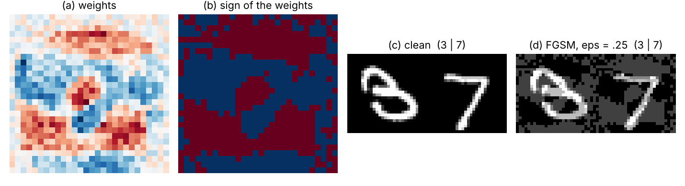
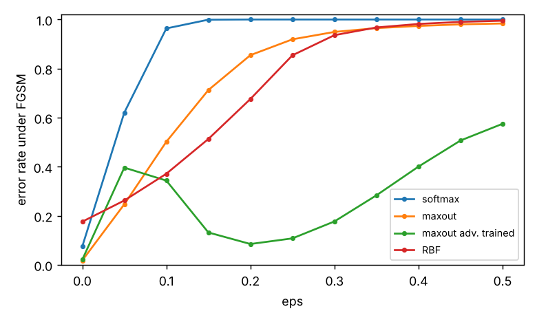
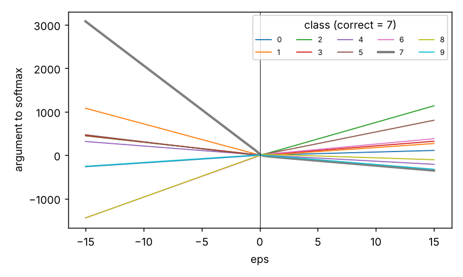
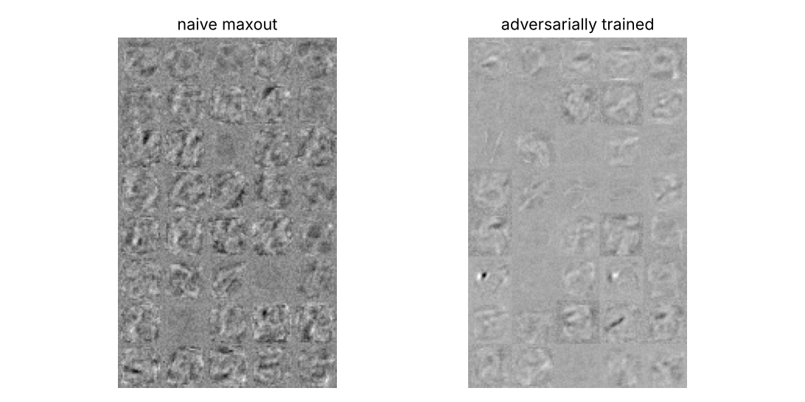
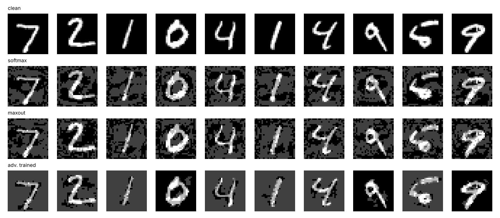

# Reproducing "Explaining and Harnessing Adversarial Examples"

[](https://github.com/Corrosifu/Projet_MLA/actions/workflows/ci.yml)


Re-implementation and experimental check of **Goodfellow, Shlens & Szegedy, *Explaining and Harnessing
Adversarial Examples*, ICLR 2015** ([arXiv:1412.6572](https://arxiv.org/abs/1412.6572)): the linear
explanation of adversarial examples, the fast gradient sign method (FGSM), adversarial training,
RBF networks, transferability and "rubbish class" inputs, on MNIST.

> **Quick definition from the paper.** Adversarial examples are "inputs formed by applying small but
> intentionally worst-case perturbations to examples from the dataset, such that the perturbed input
> results in the model outputting an incorrect answer with high confidence."

The project started as a course project (original notebooks in [`legacy/`](legacy/)). It is now a
tested Python package with a single command that trains every model, attacks it and prints each
result **next to the number reported in the paper**. Notes on the paper: [`docs/paper_notes.md`](docs/paper_notes.md).

## What this repository finds

**Reproduced (within a few points of the paper)**
- FGSM breaks every model: softmax regression 100 % error, logistic regression on 3 vs 7 **99.95 %**
  (paper: 99 %), maxout **91.9 %** (paper: 89.4 %) at `eps = 0.25`. For logistic regression the method is
  exact, and the closed form `eta = -eps (2y-1) sign(w)` matches autodiff on 100 % of the test examples.
- The activation shift `eps * ||w||_1` grows linearly with the input dimension (section 3), checked numerically.
- Adversarial training lowers the error on FGSM examples from **91.9 % to 10.8 %** (paper: 89.4 % to 17.9 %).
- Maxout on Gaussian noise: 98.6 % error with 92.9 % confidence (paper: 98.35 % / 92.8 %); the RBF network is never fooled (0 %).
- Adversarial examples transfer: softmax regression agrees with maxout's wrong class 56 % of the time (paper: 54.6 %).
- Figures 2, 3 and 4 of the paper are reproduced qualitatively (see below).

**Not reproduced**
- *The regularisation benefit of adversarial training on clean data* (test error 0.94 % to 0.84 % in the paper):
  here 1.8 % to 2.1 %, from a single run with an untuned recipe (see deviations).
- The numbers for the shallow RBF network (85 % error and 12 % confidence on mistakes versus 55 % and 1.2 %).
  The low confidence is confirmed qualitatively, but our RBF has one centre per class, so it is
  a class-centroid classifier with 17.6 % clean error.
- A few secondary numbers: softmax regression on Gaussian noise (92.6 % versus 59.8 %), the random `+-eps` noise control
  (68 % versus 86 %), and the error of the original maxout on the adversarially trained model's examples (72 % versus 41 %).
- Out of scope: Figure 1 (GoogLeNet on ImageNet), CIFAR-10, the MP-DBM and the 12-network ensemble.

**A finding that goes beyond the paper.** The adversarially trained maxout has 10.8 % error against FGSM, but
**98.2 % against a 20-step PGD attack** with the same `eps`. Its error against FGSM is also *non-monotonic* in `eps`
(40 % at 0.05, 11 % at 0.25). Training and testing with the same single-step attack mostly teaches the model to defeat
that attack (gradient masking), so the 10.8 % overstates its robustness. PGD is later work
(Madry et al., 2018; single-step adversarial training pitfalls were discussed e.g. by Kurakin et al., 2017 and Tramer et al., 2018).

## Full comparison with the paper

All values are fractions of the 10,000 MNIST test images, `eps = 0.25`, pixels in [0, 1]. Differences are in percentage points.
"Confidence" is the probability assigned to the predicted class, on the misclassified examples unless stated otherwise.

| Metric | Paper | This repo | Diff (pts) | Source |
|---|---|---|---|---|
| Logistic regression 3 vs 7: clean error | 1.6 % | 2.2 % | +0.6 | Fig. 2c |
| Logistic regression 3 vs 7: error on FGSM examples | 99.0 % | 100.0 % | +1.0 | Fig. 2d, eps = .25 |
| Softmax regression: error on FGSM examples | 99.9 % | 100.0 % | +0.1 | Sec. 4 |
| Softmax regression: confidence on those mistakes | 79.3 % | 90.5 % | +11.2 | Sec. 4 |
| Maxout: error on FGSM examples | 89.4 % | 91.9 % | +2.5 | Sec. 4 |
| Maxout: confidence on those mistakes | 97.6 % | 94.5 % | -3.1 | Sec. 4 |
| Maxout + dropout: clean test error | 0.9 % | 1.8 % | +0.8 | Sec. 6 (dropout, no adversarial training) |
| Adversarially trained maxout: clean test error | 0.8 % | 2.1 % | +1.3 | Sec. 6 (240 units); 0.782 % with 1600 units |
| Adversarially trained maxout: error on FGSM examples | 17.9 % | 10.8 % | -7.1 | Sec. 6 (1600 units) |
| Adversarially trained maxout: confidence on mistakes | 81.4 % | 70.0 % | -11.4 | Sec. 6 |
| FGSM examples of original maxout: error on adv. trained | 19.6 % | 23.3 % | +3.7 | Sec. 6 |
| FGSM examples of adv. trained maxout: error on original | 40.9 % | 72.3 % | +31.4 | Sec. 6 |
| Control, random +-eps noise: error on FGSM examples | 86.2 % | 68.4 % | -17.8 | Sec. 6 control (random +-eps noise) |
| Control, random +-eps noise: confidence on mistakes | 97.3 % | 94.2 % | -3.1 | Sec. 6 control |
| Control, uniform noise: error on FGSM examples | 90.4 % | 88.9 % | -1.5 | Sec. 6 control (U(-eps, eps) noise) |
| Control, uniform noise: confidence on mistakes | 97.8 % | 96.9 % | -0.9 | Sec. 6 control |
| Shallow RBF network: error on FGSM examples | 55.4 % | 85.4 % | +30.0 | Sec. 7 |
| Shallow RBF network: confidence on those mistakes | 1.2 % | 12.2 % | +11.0 | Sec. 7 (confidence on mistakes) |
| Shallow RBF network: average confidence on clean data | 60.6 % | 25.4 % | -35.2 | Sec. 7 |
| Gaussian noise inputs, softmax regression: error | 59.8 % | 92.6 % | +32.8 | App. A |
| Gaussian noise inputs, softmax regression: confidence | 70.8 % | 85.9 % | +15.1 | App. A |
| Gaussian noise inputs, maxout: error | 98.4 % | 98.6 % | +0.2 | App. A |
| Gaussian noise inputs, maxout: confidence | 92.8 % | 92.9 % | +0.1 | App. A |
| Gaussian noise inputs, RBF: error | 0.0 % | 0.0 % | +0.0 | App. A |
| Maxout's class predicted by softmax regression | 54.6 % | 56.1 % | +1.5 | Sec. 8 |
| Maxout's class predicted by the RBF network | 16.0 % | 25.0 % | +9.0 | Sec. 8 |
| ... same, among cases where both are wrong (softmax) | 84.6 % | 65.5 % | -19.1 | Sec. 8 |
| ... same, among cases where both are wrong (RBF) | 54.3 % | 58.4 % | +4.1 | Sec. 8 |

**Beyond the paper: PGD (20 steps) versus FGSM, eps = 0.25**

| Model | FGSM error | PGD error |
|---|---|---|
| maxout | 91.9 % | 100.0 % |
| maxout_adv_trained | 10.8 % | 98.2 % |

<p align="center">
  <br>
  <sub>Figure 2 of the paper: weights of the 3-vs-7 logistic regression, their sign (the optimal perturbation), a 3 and a 7, and their FGSM versions.</sub>
</p>

<p align="center">
  
  <br>
  <sub>Left (extra): error under FGSM versus <code>eps</code>. Right, Figure 4: the class activations are piecewise linear in <code>eps</code>.</sub>
</p>

<p align="center">
  <br>
  <sub>Figure 3: first-layer maxout filters. Adversarial training makes them sparser and more localised, as in the paper.</sub>
</p>

<p align="center">
  
</p>

## Quick start

```bash
pip install -e ".[dev]"                           # TensorFlow >= 2.16 (Keras 3); no tensorflow_addons needed

advrepro reproduce --dataset synthetic --quick    # ~15 s smoke run, no download
advrepro reproduce --controls                     # the full study on MNIST, about 13 min on 4 CPU cores
advrepro report results/results.json              # the comparison table again, as markdown
pytest                                            # 36 tests, ~30 s
```

`reproduce` writes `results/results.json`, `results/SUMMARY.md` and the figures in `figures/`.
Two runs with the same seed on the same machine gave identical numbers; they may differ slightly across
hardware and TensorFlow versions. The numbers above come from TensorFlow 2.21, Keras 3.15, Python 3.13.

## What is implemented

| Module | Content |
|---|---|
| `adv_repro.fgsm` | `fgsm` (any Keras model), `fgsm_logistic_exact` (closed form), `activation_shift`, `pgd` (extra) |
| `adv_repro.models` | softmax and logistic regression, native `Maxout` layer, `RBFOutput` (shallow RBF network) |
| `adv_repro.training` | standard training; `fit_adversarial` with the paper's objective `alpha J(x) + (1-alpha) J(x + eps sign(grad))`, noise controls, early stopping on the adversarial validation error |
| `adv_repro.metrics` | error, confidence, rubbish-class evaluation, class agreement for transferability |
| `adv_repro.experiments`, `report`, `paper` | the pipeline, and the paper's reported numbers used as reference |

## Differences from the paper

- **Training recipe.** Keras 3 / Adam (lr 1e-3) instead of Pylearn2 / Theano. Maxout: 2 layers of 240 units with 5 pieces, dropout 0.5, no input
  dropout, 20 epochs for the baseline. The paper also reports a 1600-unit model retrained on all 60,000 images; here the adversarially trained
  model has 240 units, trains on 54,000 images (6,000 held out for early stopping on the *adversarial* validation error, as in the paper)
  and stops at epoch 23 out of a maximum of 30. Hyper-parameters were not tuned.
- **Single run.** The paper averages five seeds for its best model; this study uses one seed (0), without confidence intervals.
- **Adversarial examples** are clipped to [0, 1] and generated with dropout off; training examples are regenerated from the current model at every step.
- **RBF network.** One RBF unit per class (no hidden layer), centres initialised at the class means, one-vs-rest cross-entropy.
  The paper's formula `exp((x - mu)^T beta (x - mu))` has a sign typo; the minus sign is implemented.
- **Rubbish inputs** follow the appendix: 10,000 samples of N(0, I), an error is any class probability above 0.5.

## Limitations

- Everything is evaluated with FGSM unless stated: as shown above, this overestimates the robustness of FGSM-trained models. No other attack or defence is evaluated besides the PGD check.
- One seed, one dataset (MNIST), small models: this is a check of the paper's claims, not a benchmark.
- Hyper-parameters were not searched. A quick check on the validation set showed the RBF result is insensitive to learning rate and width (clean error stays around 20 %), as expected for one centre per class.

## Repository layout

```
src/adv_repro/   the package (see above)         tests/      36 tests: maths of FGSM, models, metrics, training, pipeline
results/         results.json, SUMMARY.md        figures/    figures produced by `advrepro reproduce`
docs/            notes on the paper              legacy/     the original notebooks and their known issues
```

## From the original notebooks

The first version (notebooks in [`legacy/`](legacy/)) had useful ideas but could not be re-run, and a review against the paper found real issues,
among them images and labels paired from two different shuffled passes (so its "adversarial accuracy on the training set" was chance level),
an empty requirements file, and a dependency (`tensorflow_addons`) that is no longer maintained. They are listed in
[`legacy/README.md`](legacy/README.md). This refactor fixes them and adds the missing experiments: the paper's RBF network, the noise controls,
the rubbish-class and transferability measurements, the epsilon sweep, tests and CI.

## References

- I. J. Goodfellow, J. Shlens, C. Szegedy. *Explaining and Harnessing Adversarial Examples.* ICLR 2015. arXiv:1412.6572.
- A. Madry et al. *Towards Deep Learning Models Resistant to Adversarial Attacks.* ICLR 2018.
- A. Kurakin, I. Goodfellow, S. Bengio. *Adversarial Machine Learning at Scale.* ICLR 2017.
- F. Tramer et al. *Ensemble Adversarial Training: Attacks and Defenses.* ICLR 2018.
